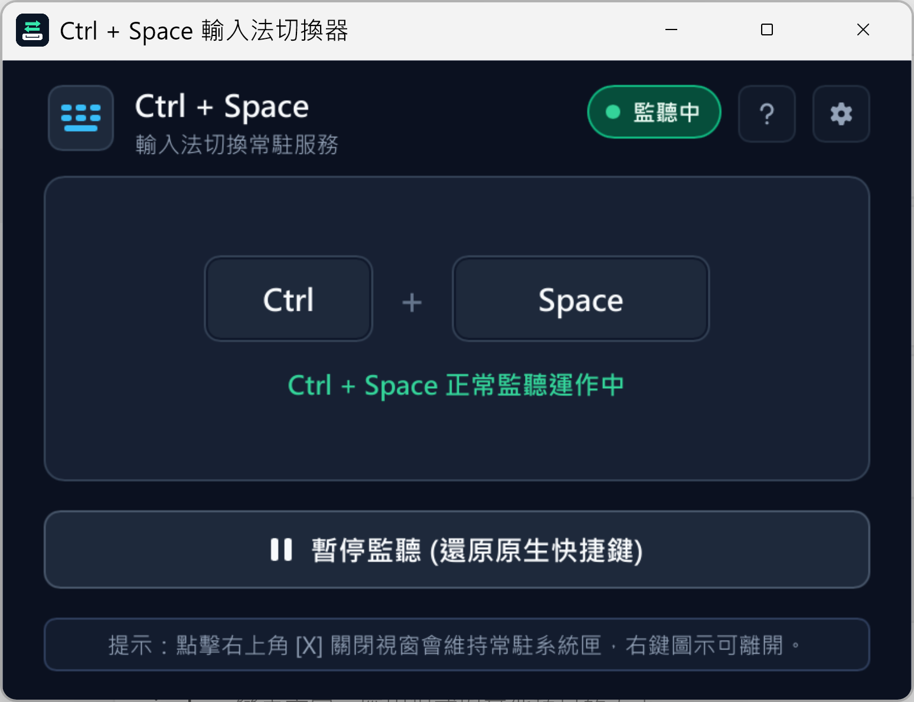

  

[繁體中文](../../README.md) · **简体中文** · [English](README_en.md)

# Ctrl+Space 输入法切换器 (Ctrl+Space Switcher)

### 还原 Windows 经典 Ctrl+Space 输入法切换习惯
专为打字员、办公族、输入法爱好者与注重操作流畅度的使用者打造

**完美找回经典 Ctrl+Space 肌肉记忆！**

[软件简介](#-软件简介) · [核心功能](#-核心功能) · [软件操作画面](#-软件操作画面) · [下载与使用说明](#-下载与使用说明) · [系统兼容性](#-系统兼容性与需求) · [常见问题](#-常见问题-faq) · [问题反馈](#-问题反馈与支持)

---

## 📖 软件简介

自 Windows 8、Windows 10 到 Windows 11，系统将默认的输入法切换快捷键调整为 Win + Space，并将中英文切换简化为按一下 Shift。这对于习惯早期 Windows 经典 Ctrl + Space 的用户造成困扰，切换时经常按错键。

更令人困扰的是，在现代 Windows 系统中尝试改回 Ctrl + Space，常常遇到很多问题：
- **快捷键被其他软件占用**：许多常见的办公软件、快速搜索或截图工具默认都使用了这组快捷键。一旦被占用，系统原本的切换功能就直接失效。
- **多款输入法无法顺畅切换**：如果您同时安装了两种以上的中文输入法，系统常常卡在中英文切换，无法顺畅循环切换到下一款输入法。

**「Ctrl+Space 输入法切换器 (Ctrl+Space Switcher)」** 是一款专为彻底解决上述困扰打造的原生绿色免安装实用工具。无须安装额外软件环境或支持库，点开即可使用，让您重温最顺手流畅的打字体验！

---

## ✨ 核心功能

### 1. 🔄 智能兼容多款输入法循环
- 解决了 Windows 系统在同时安装多款输入法时无法依次循环切换的困扰。
- 拼音、五笔、注音、仓颉及英数状态皆能顺畅无缝循环切换，打字一气呵成。

### 2. 🔍 清晰的热键冲突检测
- 内置智能冲突识别机制，若有其他后台工具正在占用快捷键，程序会贴心提示冲突状态并提供优化建议。
- 绝不随意终止用户的其他程序，安全无干扰。

### 3. 💻 系统托盘常驻与开机自启动整合
- 支持开机自动静默启动（直接最小化常驻于右下角系统托盘），开机即用无需手动开启。
- 单一实例保护，防止重复开启；托盘菜单一键快速呼出界面或暂停监听。

### 4. 🛡️ 全平台系统兼容支持
- 全面支持 Windows 7、Windows 8/8.1、Windows 10 与 Windows 11（兼容 32 位与 64 位架构）。

---

## 📸 软件操作画面

  

---

## 📦 下载与使用说明

### 📥 下载方式
1. 前往本项目的 [Releases 页面](https://github.com/robert820/ctrl-space-switcher/releases) 下载最新版绿色执行文件。
2. 本程序为**单文件免安装绿色执行程序**，无须安装额外依赖库，下载即可随处运行。

### 🚀 使用指南
1. 直接双击运行程序，窗口显示监听状态即表示功能已启用。
2. 按下经典快捷键 Ctrl + Space，即可享受零延迟的输入法切换！
3. 点击右上角关闭或最小化按钮，程序将自动隐藏至右下角系统托盘持续为您服务。

---

## 🖥️ 系统兼容性与需求
- **操作系统**：Windows 11 / 10 / 8.1 / 8 / 7
- **硬件架构**：64 位 (x64) 与 32 位 (x86) 通用支持
- **运行权限**：标准普通用户权限即可直接运行，无须强制管理员权限
- **运行环境**：单文件原生绿色程序，无须额外安装任何软件环境

---

## ❓ 常见问题 (FAQ)

<b>Q1: 这款软件完全免费吗？</b>

A: 是的！本软件完全免费（Freeware），个人与企业内部均可免费自由使用。但严禁将本软件单独售卖、出租、重新打包或恶意修改分发。

<b>Q2: 为什么我按下 Ctrl + Space 没有切换，而是弹出了其他软件？</b>

A: 这通常表示电脑中有其他开机自启的软件先一步占用了这组快捷键。您可以打开本工具的设置面板查看冲突提示，或至该软件中将其快捷键改为其他按键。

<b>Q3: 为什么杀毒软件偶尔会提示或误报？</b>

A: 本软件为 100% 纯净绿色工具，绝无任何恶意代码、后门或广告。由于全局按键切换需要监听键盘事件，部分杀毒软件的严格扫描可能会较为敏感，请放心将本工具加入信任列表。

---

## 💬 问题反馈与支持
- 🐛 **错误反馈与功能建议**：欢迎至本项目的 [Issues 页面](https://github.com/robert820/ctrl-space-switcher/issues) 提出。
- 🌐 **得翼科技官方网站**：[https://blog.dei3c.com](https://blog.dei3c.com)

---

## 📄 授权条款 (License)
本软件采用专有免费软件授权（Proprietary Freeware），完整授权规范、使用条款与免责声明请参阅 [LICENSE](../../LICENSE) 文件。
